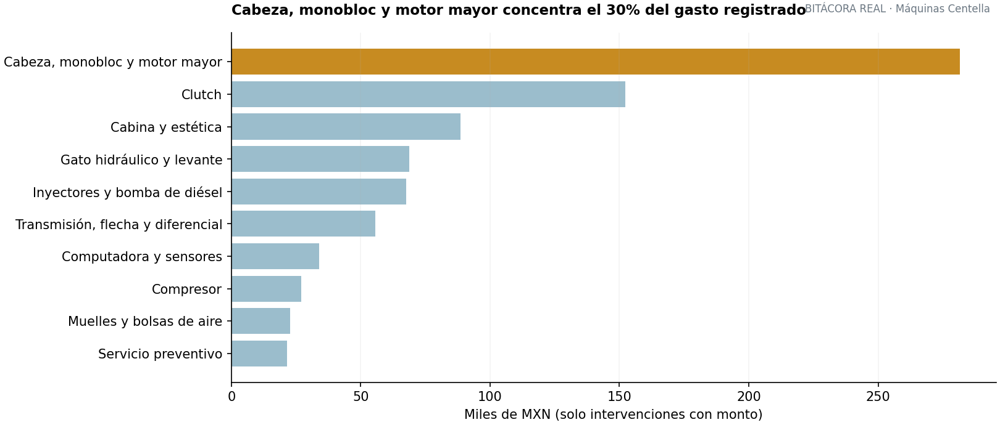
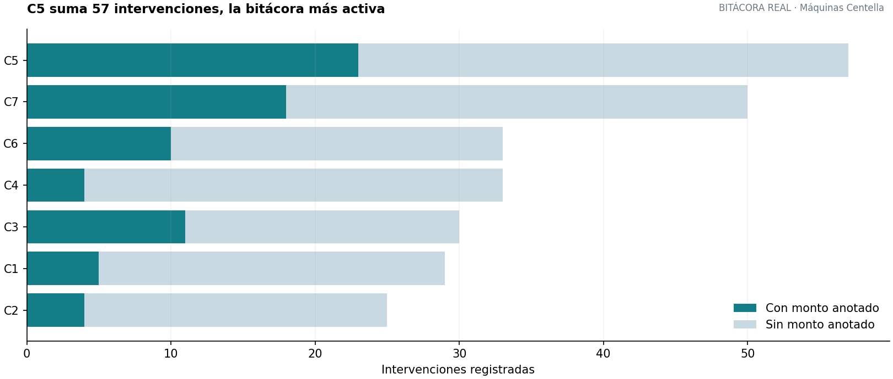
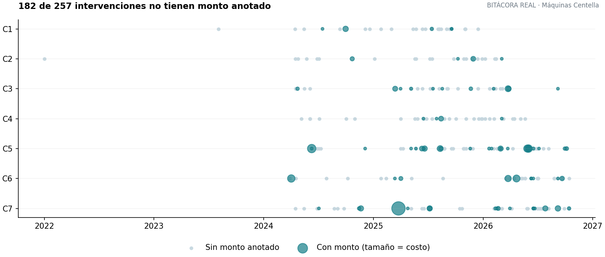
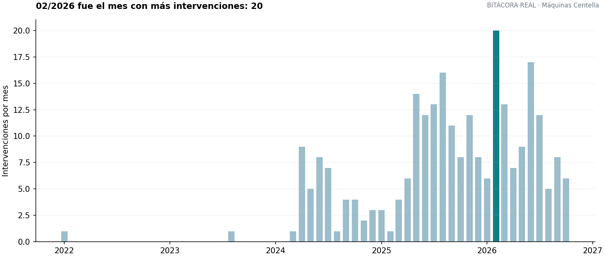
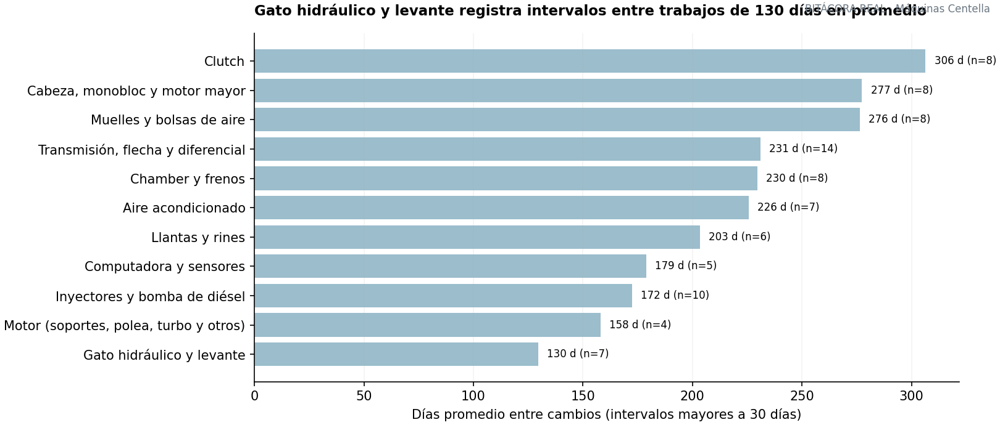
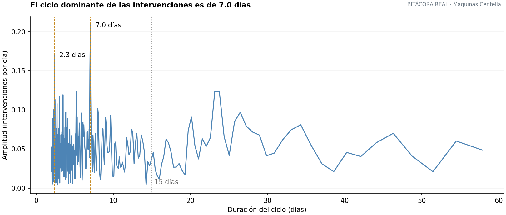
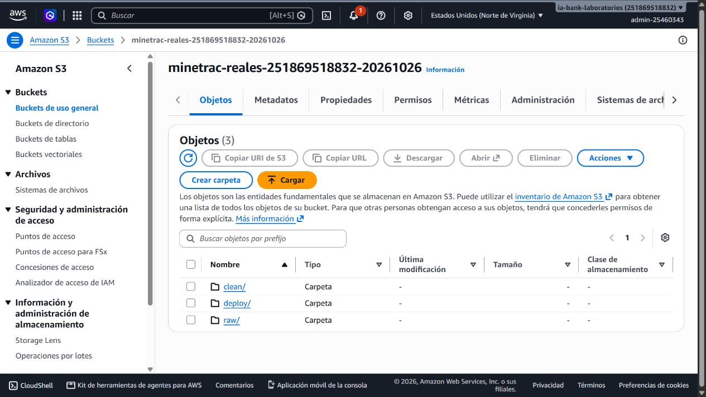
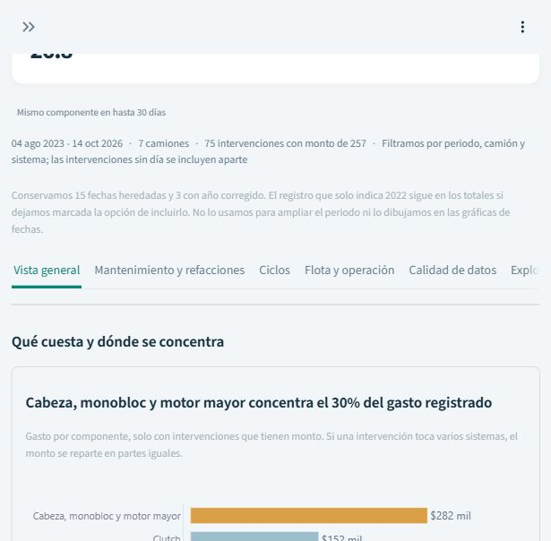

# E1. Dashboard empresarial de MineTrac

## Contexto y procedencia

MineTrac apoya a Máquinas Centella S.A. de C.V. a controlar costos, mantenimiento y operación de su maquinaria pesada. Esta es la entrega E1 (26 de octubre de 2026) del Proyecto Integrador Data Startup del TecNM campus Colima.

Datos reales que nos entregó la empresa: (1) el catálogo de 21 equipos (11 cargadores, 2 minicargadores, 1 retroexcavadora y 7 camiones) y (2) la bitácora de reparaciones de los 7 camiones, una hoja por camión, con 257 intervenciones y $928,832 MXN de gasto anotado. También recibimos un documento de contexto con tres módulos: refacciones e insumos, operación y registro de trabajo, y balance financiero por equipo.

Este informe y el tablero usan únicamente esa información. No se generan registros simulados ni se imputan montos faltantes. Las fechas corregidas, las clasificaciones y el reparto de costos son transformaciones analíticas, identificadas y pendientes de validación. Las horas trabajadas, las toneladas, las tarifas y los ingresos todavía no existen en formato digital: la empresa los lleva en papel y, según su carta del 25 de octubre de 2026, está recopilando, revisando y consolidando la información con sus departamentos en un archivo de Excel. Por eso el balance financiero por equipo y el indicador de tarifas quedan pendientes y se incorporarán cuando llegue ese archivo.

## Pregunta de negocio

Pregunta de negocio: ¿qué refacciones pesan más en el gasto de mantenimiento, qué camiones se reparan más y cuánto se repite un mismo trabajo? Pregunta analítica: medir el gasto y la repetición de cambios por componente y por camión, y detectar periodicidades en las intervenciones. La señal para la FFT es el conteo diario de intervenciones registradas.

## Datos y procedimiento

Cada fila del Excel es una intervención. Un módulo de limpieza (services/worker/etl_bitacora.py) la convierte en una tabla ordenada con una fila por intervención y sistema: 317 registros. Las fechas se corrigen con el orden cronológico de cada hoja, los montos se reparten en partes iguales entre los sistemas de una misma intervención, las piezas se clasifican con palabras clave del texto y se omiten nombres de proveedores; este procesamiento no detectó proveedores y conserva sin_dato. El texto libre y los nombres no salen del módulo hacia el tablero ni al repositorio. La clasificación de componente y la condición de la pieza (nueva o reparada) son una interpretación del texto y deben validarse con la empresa.

Solo 29% de las intervenciones (75 de 257) trae monto, por lo que el gasto del tablero es una suma parcial y no el gasto total. Los montos que faltan no se inventan.

## Limpieza reproducible y auditoría

La bitácora ya traía errores de captura. Se revisaron los cinco tipos que pide la guía. Nulos: 182 intervenciones sin monto (se dejan sin monto) y 15 filas sin fecha (heredan la de la fila anterior). Duplicados: 0. Negativos: 0. Atípicos: 1 (un ajuste completo de motor de $149,000 MXN en el camión C7, por encima del límite de $52,900; se conserva por estar anotado, pendiente de validar con comprobante). Formato: 16 problemas, entre ellos 4 fechas escritas a mano, 3 años equivocados (incluida una fecha de 2029), 1 fecha con solo el año, 6 montos escritos dentro del texto, 1 texto en la columna de costo y 1 monto en la columna de servicio. Filas recibidas: 317. Filas limpias: 317. Residuales: los 182 montos que nadie anotó y el atípico verificado.

## Cuatro KPIs visibles

1. Intervenciones: 257. Eventos distintos de la bitácora; cada intervención cuenta una vez aunque toque varios sistemas.

2. Gasto registrado: $928,832 MXN. Suma de los montos anotados; es una suma parcial, pendiente de conciliar con comprobantes.

3. Costo promedio: $12,384 MXN por intervención con monto.

4. Repeticiones por 100 intervenciones: 26.8 (69 trabajos sobre el mismo componente del mismo camión en hasta 30 días). Es una razón por componente y fecha, no el porcentaje de intervenciones fallidas.

Los valores corresponden a toda la bitácora; cada filtro del tablero (periodo, camión y sistema) los recalcula. Si una selección no tiene datos se muestra un aviso y no un indicador en cero.

## Seis visualizaciones con hallazgos

### 1. Cabeza, monobloc y motor mayor concentra el 30% del gasto registrado

Gasto registrado por componente. Cabeza, monobloc y motor mayor y Clutch suman 47% del gasto anotado. Un componente con poco gasto puede ser solo uno cuyo monto no se anotó.

### 2. C5 suma 57 intervenciones, la bitácora más activa

Intervenciones por camión. En gris están las que no tienen monto: 71% del total. Más intervenciones no significa un camión peor; también depende de cuánto trabaja.

### 3. 182 de 257 intervenciones no tienen monto anotado

Cada punto es una intervención. Los puntos grises no tienen monto, lo que muestra qué tan incompleta es la captura de costos.

### 4. 02/2026 fue el mes con más intervenciones: 20

Intervenciones por mes en toda la flota. Sirve para ver cargas de trabajo del taller, no para predecir fallas.

### 5. Gato hidráulico y levante registra intervalos entre trabajos de 130 días en promedio

Con las fechas de cambios repetidos se estima cada cuánto se vuelve a trabajar un componente. Es una aproximación: falta el horómetro al momento del cambio para medir horas de servicio.

### 6. El ciclo dominante de las intervenciones es de 7.0 días

Análisis de Fourier de las intervenciones diarias. El ciclo de 7 días tiene una fuerza 4.6 veces la mediana del espectro, mientras que el de 15 días tiene 1.5.

## FFT e interpretación en días

Se cuentan las intervenciones por día desde el 2024-04-02 hasta el 2026-10-14 (926 días, con ceros en los días sin registro), se resta la tendencia lineal y se aplica una ventana de Hann antes de la FFT. Frecuencia de muestreo: una observación por día. Primer pico: f=0.142549 ciclos/día, T=1/f=7.02 días. Un ciclo de 7 días significa que el registro de intervenciones se repite cada semana (por ejemplo, días de la semana en que el taller recibe o entrega camiones). No significa que un camión falle con esa frecuencia.

El ciclo de 15 días (quincena) no supera el umbral descriptivo: su fuerza es 1.5 veces la mediana del espectro, es decir, no supera el umbral descriptivo de 2.5 veces la mediana, sin prueba formal de significancia. Lo reportamos tal cual: con 257 intervenciones en unos 900 días la señal es débil, y 15 fechas de la bitácora se completaron con la de la fila anterior, lo que puede suavizar o crear patrones. Cuando lleguen las horas trabajadas por día se repetirá el análisis sobre esa señal, que es la que sí permite hablar de ciclos de operación.

## Tres recomendaciones gerenciales

1. Presupuestar cabeza, monobloc y motor mayor y cotizar con más de un proveedor. Concentra 30% del gasto con monto anotado ($281,538 MXN). Pedir cotizaciones comparables antes de la siguiente compra grande.

2. Revisar el historial del camión C5 antes de otra reparación mayor. Acumula 57 intervenciones. En la flota, 69 repeticiones (26.8 por cada 100 intervenciones) se repitieron sobre el mismo componente en hasta 30 días: solicitar diagnóstico y validar si fueron continuaciones del mismo trabajo antes de reclamar garantía.

3. Registrar monto, tipo de pieza y horómetro en cada reparación. Solo 29% de las intervenciones tiene monto anotado. Sin tipo de pieza (original o genérica) y horómetro al cambio no se puede calcular el costo por hora útil ni decidir qué refacción conviene.

## Implementación del dashboard

Streamlit muestra una franja que indica qué datos son reales y qué está pendiente, cuatro tarjetas (la cuarta es una razón por 100 intervenciones), filtros de periodo, camión y sistema, seis gráficas interactivas, seis pestañas (Vista general, Mantenimiento y refacciones, Ciclos, Flota y operación, Calidad de datos y Explorar datos) y descargas en CSV. La pestaña Flota y operación muestra el catálogo de 21 equipos y explica que la operación está pendiente de entrega por la empresa.

El modo s3 lee clean/mantenimiento.csv, clean/inventario.csv y clean/resultados.json con boto3 y credenciales temporales de la instancia. No hay contraseñas ni claves en el repositorio. Si la lectura falla, el tablero lo informa y no la sustituye con una copia local.

## Nube y presupuesto

Arquitectura verificada el 26 de octubre de 2026: pipeline de limpieza -> bucket S3 privado minetrac-reales-251869518832-20261026 en us-east-1, con raw/ (dos Excel originales) y clean/ (cuatro archivos depurados) -> Streamlit en EC2 t3.micro. URL: http://54.204.60.100:8501/ . Stack: minetrac-e1-reales. Usuario de despliegue: admin-25460343; rol de instancia minetrac-e1-reales-ReadRole-XxCmmx32Dnlz, con lectura de tres tablas clean y del ZIP de aplicación; ListBucket limitado por prefijo. El rol no lee raw/. Bloqueo público de S3 activado y cifrado AES256; disco cifrado e IMDSv2. Puerto 8501 para el tablero, sin SSH público. No se guardan claves. Si S3 falla no se usan copias locales. Evidencias: evidencias/s3_raw_clean_real.png, evidencias/dashboard_real_aws.png, evidencias/iam_y_seguridad_real.png. Presupuesto objetivo $0; se conserva la alerta mensual de $1 USD con umbral real $0.01 USD. EC2, disco e IPv4 pueden consumir créditos o generar cargos; la alerta no detiene el consumo. La URL HTTP es para la entrega académica autorizada; no captura credenciales ni datos adicionales.

## Verificación

Pruebas automáticas (pytest): indicadores de un caso pequeño hecho a mano; calendario diario completo; FFT con periodos conocidos y rechazo de series cortas o con huecos; lectura de fechas escritas a mano; corrección de años equivocados; montos en texto; reparto de costos entre sistemas (el total se conserva); conteos de la bitácora real (257 intervenciones, 75 con monto, $928,832); seis gráficas y tres recomendaciones.

## Defensa individual

¿Qué proviene de la empresa? El catálogo y la bitácora. Los indicadores son cálculos; las fechas inferidas y la clasificación de piezas requieren validación. ¿Qué falta? Horas, toneladas, tarifas e ingresos; la empresa los está consolidando en un Excel.

¿Por qué no se inventan los montos que faltan? Porque 71% de las intervenciones no trae monto y rellenarlo cambiaría las conclusiones. Se reporta cuánto falta.

¿Qué significa 0.142857 ciclos/día? Un ciclo cada 7 días. No significa que una máquina falle cada semana.

¿Por qué el ciclo de 15 días no aparece? Porque en la bitácora real no supera ese umbral descriptivo. La guía lo pide como ejemplo de lo que se debe buscar, y reportamos el resultado honesto.

¿Por qué raw y clean? raw conserva los originales para auditar; clean tiene el esquema listo para los indicadores.

## Pendientes con el cliente

Excel consolidado de la empresa (horas trabajadas por turno, toneladas, tarifas y horómetro); tipo de pieza (original o genérica) y proveedor en cada compra; lectura del horómetro al cambiar una pieza; fecha de falla y de regreso a operación de cada paro (para medir las horas fuera de servicio que pidió la empresa en la entrevista); montos de las intervenciones sin costo; y validar la clasificación de componentes. Con esos datos el tablero podrá calcular el costo por hora útil de cada refacción y el balance financiero por equipo, que son los módulos 1 y 3 del documento de contexto.

## Límites de interpretación y entrega parcial

La entrega se presenta con la información disponible, conforme a lo acordado con los profesores según lo informado por el equipo. La carta del 25 de octubre acredita que la empresa consolida datos; no certifica cifras ni la aprobación académica. Se adjunta sin modificar.

La bitácora limpia contiene una fecha 2022-01-01 creada como referencia al disponer solo del año 2022; ese día no fue observado. Hay 15 intervenciones con fecha heredada, 3 con año corregido y 4 con texto interpretado. fecha_calidad permite distinguirlas. Los totales monetarios no dependen de estas fechas, pero los filtros, intervalos y FFT sí. No se calculan ingresos, margen, disponibilidad ni costo por hora sin sus datos.

El control de duplicados del módulo identifica repeticiones dentro de una misma fila de origen; no permite afirmar que no haya intervenciones duplicadas entre filas distintas. Los 182 montos faltantes permanecen nulos. El monto atípico de $149,000 está anotado, pero no se verificó con factura. Los intervalos mayores de 30 días excluyen las repeticiones cortas y no representan vida útil. La ausencia de registro diario se representa con cero intervenciones registradas, no prueba ausencia de fallas ni captura completa.

## Referencias

Guía oficial PROYECTO_INTEGRADOR_DATA_STARTUP_ALUMNOS: E1 y rúbrica. Documento de contexto Maquina Centella Contexto. Carta de Máquinas Centella del 25 de octubre de 2026.

Documentación técnica: AWS S3 (https://docs.aws.amazon.com/AmazonS3/latest/userguide/Welcome.html); Streamlit (https://docs.streamlit.io/develop/api-reference); NumPy FFT (https://numpy.org/doc/stable/reference/routines.fft.html).