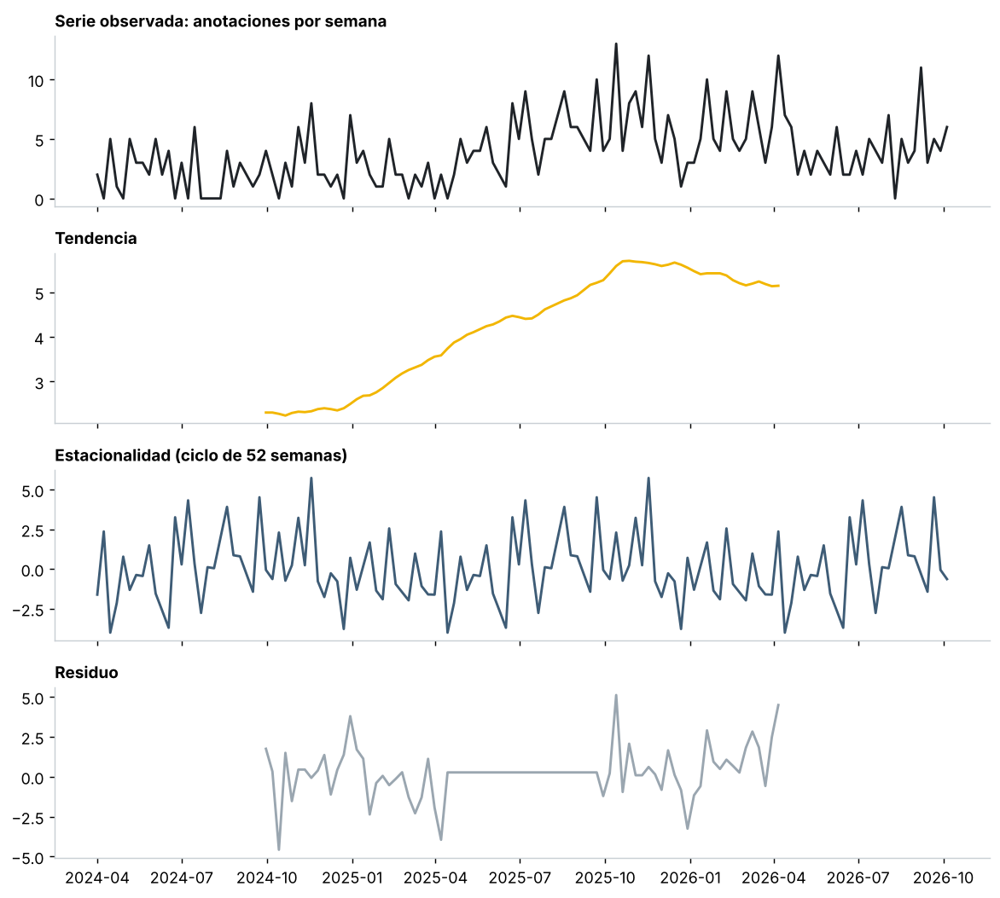
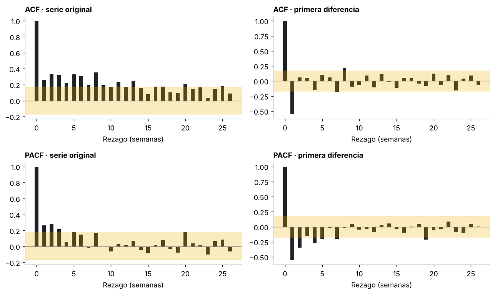
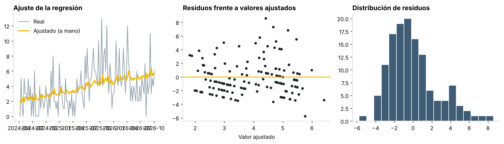

# E2 · Arquitectura, análisis y pruebas de limpieza

MineTrac · Máquinas Centella S.A. de C.V. · Proyecto Integrador DATA STARTUP · TecNM Colima

## 1. Arquitectura

| Componente | Tecnología | Dónde está | Responsabilidad |
|---|---|---|---|
| Ingesta | FastAPI | `services/ingesta/main.py` (puerto 8000, OpenAPI en `/docs`) | Valida el CSV (vacío, 5 MB, columnas obligatorias `equipo_id` y `fecha`, columnas no permitidas), registra el job y encola. Responde 202. |
| Cola | Amazon SQS (ElasticMQ en local) | `services/worker/cola.py` | Desacopla la ingesta del procesamiento. Visibilidad de 30 s, 3 intentos y cola de mensajes muertos. |
| Worker | Python | `services/worker/worker.py` | Toma el mensaje, limpia, guarda en PostgreSQL. Idempotente: un reintento borra lo anterior del job y no duplica. |
| Limpieza | pandas | `services/worker/limpieza.py` + `tests/test_limpieza.py` | Reglas automáticas con pruebas (sección 3). |
| Base de datos | PostgreSQL 16 (SQLite solo en pruebas) | `services/worker/db.py` | Tablas `jobs` y `eventos`. |
| Modelos | NumPy, statsmodels | `services/worker/analitica.py`, `scripts/pipeline_e2.py` | Serie semanal, descomposición, ADF, ACF/PACF y regresión a mano. |
| Tablero v2 | Streamlit | `services/tablero/` (pestaña Predicción) | Selecciones (semanas a predecir, suavizado) y predicción. |

Pila local sin costo: `docker compose up --build` levanta PostgreSQL, ElasticMQ, ingesta, worker y tablero.
Nube: `infra/e2_aws.sh` crea la cola SQS (con cola de mensajes muertos), da permisos al rol de la instancia y levanta PostgreSQL, ingesta y worker en la EC2 del E1 (`infra/docker-compose.aws.yml`).

Presupuesto: 0 USD adicionales (EC2 y S3 del E1, SQS dentro del nivel gratuito, PostgreSQL en contenedor).

### Flujo de la demostración extremo a extremo
`python scripts/demo_e2e.py http://<IP>:8000 data/sample/ejemplo_ingesta.csv` sube el CSV, espera al worker e imprime el tiempo total. En la prueba local (API real por HTTP, worker en segundo plano) tardó 1.0 s con 5 filas: 3 limpias y 2 rechazadas (una con `equipo_id` inválido y un duplicado). Meta del curso: menos de 300 s.

## 2. Análisis de series de tiempo y regresión

**Serie.** Anotaciones por semana de la libreta de taller: 132 semanas (1 de abril de 2024 a 5 de octubre de 2026), 516 anotaciones, 14 semanas sin anotaciones (valen 0). Se eligió esta serie porque la bitácora de camiones es demasiado dispersa en el tiempo para un análisis semanal.

- **Descomposición aditiva** (periodo 52). Fuerza de la tendencia 0.47. La fuerza estacional sale 0.65, pero está inflada: con 132 semanas hay solo 2.5 ciclos de 52 semanas, y varias posiciones del ciclo tienen una sola observación con tendencia calculable, así que el componente estacional absorbe ese dato y el residuo queda plano en ese tramo (se ve entre abril y octubre de 2025). La estacionalidad anual no se puede confirmar con esta historia; lo que sí se ve con claridad es la tendencia: sube de ~2.3 a ~5.7 anotaciones por semana entre 2024 y finales de 2025 y se estabiliza.
- **ADF (H0: raíz unitaria).** Serie original: estadístico −1.71, p = 0.428 (crítico al 5%: −2.89) → no se rechaza H0; no es estacionaria. Primera diferencia: −7.14, p = 3.3×10⁻¹⁰ → estacionaria.

- **ACF/PACF.** La serie original tiene ACF de 0.26, 0.33, 0.32 y 0.22 en los rezagos 1 a 4, todos sobre la banda de 95% (±0.17). La PACF del rezago 1 es 0.26. Esto justifica incluir la semana anterior como regresor.

## 3. Regresión lineal calculada a mano

Modelo: `anotaciones_t = β0 + β1·t + β2·anotaciones_(t-1) + ε`, con β = (XᵀX)⁻¹Xᵀy en NumPy (`ols_a_mano`). scikit-learn solo verifica el resultado.

| Variable | β | Error estándar | t | p |
|---|---|---|---|---|
| Constante | 1.7596 | 0.4880 | 3.61 | 0.0004 |
| Tendencia (semanas) | 0.0251 | 0.0065 | 3.86 | 0.0002 |
| Anotaciones semana anterior | 0.1308 | 0.0876 | 1.49 | 0.138 |

n = 131 · R² = 0.166 · R² ajustado = 0.153 · RMSE = 2.56 anotaciones por semana.
**Comparación con scikit-learn:** los tres coeficientes coinciden con diferencia máxima de 5.8×10⁻¹⁵ (`tests/test_analitica.py`).

**Análisis de residuos.** Media ≈ 0 (1×10⁻¹⁵, garantizado por la constante). Durbin-Watson 2.05: sin autocorrelación de primer orden. Shapiro-Wilk p = 2.9×10⁻⁵: no son normales (cola derecha), esperable en conteos. El intervalo ±1.96·RMSE es una aproximación.

**Lectura honesta.** La tendencia es significativa (≈ +0.025 anotaciones por semana, unas 3 más por semana al cabo de los 2.5 años), pero el modelo explica solo 17% de la variación. Sirve para estimar el ritmo de trabajo del taller, no para predecir cada falla. La libreta está transcrita de fotos y sin validar.

## 4. Pruebas de limpieza automatizada

Archivo: `tests/test_limpieza.py` (el worker usa las mismas funciones). Ejecutar: `python -m pytest tests/test_limpieza.py -v`.

| Regla | Qué hace | Prueba |
|---|---|---|
| `normalizar_id` | Quita espacios y guiones, mayúsculas; acepta `K1`, `M2`, `C07`; rechaza el resto | `test_normalizar_id` (6 casos) |
| `normalizar_fecha` | Acepta ISO y día/mes/año; rechaza futuras, anteriores a 2015 y texto | `test_fecha_formatos_y_rangos` |
| `normalizar_sistema` | Acentos y sinónimos → catálogo; desconocido → `otro` | `test_sistema` |
| `normalizar_monto` | Quita `$` y comas; rechaza negativos, texto y más de 5 millones | `test_monto` |
| `limpiar` | Devuelve limpios y rechazados con motivo; deduplica | `test_limpiar_rechaza_y_deduplica`, `test_limpiar_columnas_opcionales_ausentes` |

Pruebas del flujo (`tests/test_ingesta_cola_worker.py`): flujo completo API → cola → worker → base; 4 validaciones de entrada (400/422); job inexistente (404) y OpenAPI; tres fallos seguidos → job `fallido` y mensaje en la cola de muertos; fallo y reintento exitoso sin duplicar filas; cola SQS simulada con moto (envío, recepción, contador de intentos y borrado).

Suite completa: **41 pruebas pasan** (`python -m pytest -q`).

## 5. Pendiente de ejecutar por el equipo
- Correr `infra/e2_aws.sh` en CloudShell (no se pudo probar contra AWS desde el entorno de desarrollo) y tomar capturas de `/docs`, de una carga con `demo_e2e.py` y del tablero.
- La carga de PostgreSQL en la nube es un contenedor en la EC2; migrar a RDS es opcional.
- Diagrama de la nube con los nombres reales de recursos, si el profesor lo pide con ese detalle.
