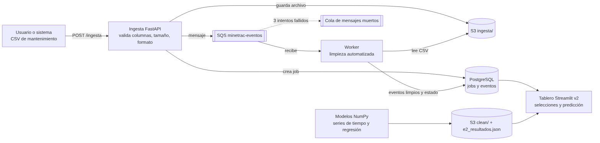
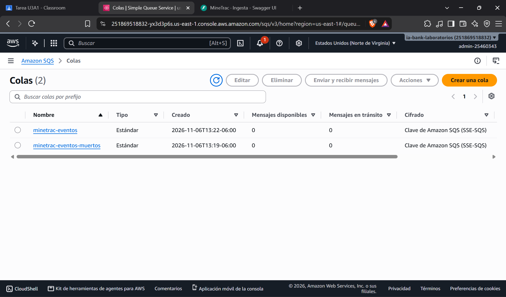

# E2 · Arquitectura, análisis y pruebas de limpieza

MineTrac · Máquinas Centella S.A. de C.V. · Proyecto Integrador DATA STARTUP · TecNM Colima

## 1. Arquitectura

| Componente | Tecnología | Dónde está | Responsabilidad |
|---|---|---|---|
| Ingesta | FastAPI | `services/ingesta/main.py` (puerto 8000, OpenAPI en `/docs`) | Valida el CSV (vacío, 5 MB, columnas obligatorias `equipo_id` y `fecha`, columnas no permitidas), registra el job y encola. Responde 202. |
| Cola | Amazon SQS (ElasticMQ en local) | `services/worker/cola.py` | Desacopla la ingesta del procesamiento. Visibilidad de 30 s, 3 intentos y cola de mensajes muertos. |
| Worker | Python | `services/worker/worker.py` | Toma el mensaje, limpia, guarda en PostgreSQL. Idempotente: un reintento borra lo anterior del job y no duplica. |
| Limpieza | pandas | `services/worker/limpieza.py` + `tests/test_limpieza.py` | Reglas automáticas con pruebas (sección 3). |
| Base de datos | PostgreSQL 16 (SQLite solo en pruebas) | `services/worker/db.py` | Tablas `jobs` y `eventos`. |
| Modelos | NumPy, statsmodels | `services/worker/analitica.py`, `scripts/pipeline_e2.py` | Serie semanal, descomposición, ADF, ACF/PACF y regresión a mano. |
| Tablero v2 | Streamlit | `services/tablero/` (pestaña Predicción) | Selecciones (semanas a predecir, suavizado) y predicción. |

Pila local sin costo: `docker compose up --build` levanta PostgreSQL, ElasticMQ, ingesta, worker y tablero.
Nube: `infra/e2_aws.sh` crea la cola SQS (con cola de mensajes muertos), da permisos al rol de la instancia y levanta PostgreSQL, ingesta y worker en la EC2 del E1 (`infra/docker-compose.aws.yml`).

Presupuesto: 0 USD adicionales (EC2 y S3 del E1, SQS dentro del nivel gratuito, PostgreSQL en contenedor).

### Flujo de la demostración extremo a extremo
`python scripts/demo_e2e.py http://<IP>:8000 data/sample/ejemplo_ingesta.csv` sube el CSV, espera al worker e imprime el tiempo total. En la prueba local (API real por HTTP, worker en segundo plano) tardó 1.0 s con 5 filas: 3 limpias y 2 rechazadas (una con `equipo_id` inválido y un duplicado). Meta del curso: menos de 300 s.

## 2. Análisis de series de tiempo y regresión

**Serie.** Intervenciones por semana de los 7 camiones (una intervención que toca varios sistemas cuenta una vez): 132 semanas (1 de abril de 2024 a 5 de octubre de 2026), 251 intervenciones, 34 semanas sin intervenciones (valen 0). Antes de abril de 2024 la bitácora solo trae 3 intervenciones sueltas, por eso la serie empieza ahí. La serie es corta y de conteos pequeños (promedio de 1.9 por semana, máximo 7); eso limita lo que el modelo puede explicar.

- **Descomposición aditiva** (periodo 52). Fuerza de la tendencia 0.36. La fuerza estacional sale 0.72, pero está inflada: con 132 semanas hay solo 2.5 ciclos de 52 semanas, y varias posiciones del ciclo tienen una sola observación con tendencia calculable, así que el componente estacional absorbe ese dato y el residuo queda plano en ese tramo (se ve entre abril y octubre de 2025). La estacionalidad anual no se puede confirmar con esta historia. Lo que sí se ve es la tendencia: durante 2024 el taller registra cerca de 1 intervención por semana, sube hasta unas 2.7 a principios de 2026 y después baja un poco.
- **ADF (H0: raíz unitaria).** Serie original: estadístico −3.30, p = 0.015 (crítico al 5%: −2.88) → se rechaza H0; la serie es estacionaria al 5%, aunque con una tendencia suave y con mucho ruido. Primera diferencia: −11.99, p = 3.5×10⁻²² → estacionaria con holgura.

- **ACF/PACF.** La serie original tiene ACF de 0.22, 0.10, 0.30 y 0.27 en los rezagos 1 a 4; los rezagos 1, 3 y 4 superan la banda de 95% (±0.17) y el 2 no. La PACF del rezago 1 es 0.22 y la del 3 es 0.28. Hay algo de memoria (la actividad de una semana se parece a la de las anteriores), sin un patrón fuerte. Esto justifica incluir la semana anterior como regresor.

## 3. Regresión lineal calculada a mano

Modelo: `intervenciones_t = β0 + β1·t + β2·intervenciones_(t-1) + ε`, con β = (XᵀX)⁻¹Xᵀy en NumPy (`ols_a_mano`). scikit-learn solo verifica el resultado.

| Variable | β | Error estándar | t | p |
|---|---|---|---|---|
| Constante | 0.8626 | 0.3205 | 2.69 | 0.0081 |
| Tendencia (semanas) | 0.0116 | 0.0042 | 2.74 | 0.0070 |
| Intervenciones semana anterior | 0.1465 | 0.0875 | 1.67 | 0.0965 |

n = 131 · R² = 0.099 · R² ajustado = 0.085 · RMSE = 1.74 intervenciones por semana.
**Comparación con scikit-learn:** los tres coeficientes coinciden con diferencia máxima de 2.2×10⁻¹⁶ (`tests/test_analitica.py`).

**Análisis de residuos.** Media ≈ 0 (−2×10⁻¹⁶, garantizado por la constante). Durbin-Watson 2.00: sin autocorrelación de primer orden. Shapiro-Wilk p = 1.2×10⁻⁶: no son normales, con cola a la derecha (semanas con muchas intervenciones juntas). En la gráfica de residuos contra valor ajustado se ven líneas diagonales, propias de los conteos enteros. Por eso el intervalo ±1.96·RMSE es solo una aproximación y el modelo se presenta como referencia, no como pronóstico exacto.

**Lectura honesta.** La tendencia es significativa (≈ +0.012 intervenciones por semana, unas 1.5 más por semana al cabo de los 2.5 años), pero el modelo explica solo 10% de la variación. Sirve para estimar el ritmo de trabajo del taller, no para predecir cada falla. Hay fechas inferidas por el orden de la hoja (ver sensibilidad abajo) y los resultados no cambian de conclusión al excluirlas.

**Sensibilidad a las fechas inferidas.** De las 257 intervenciones, 234 tienen fecha firme, 15 la heredan de la fila anterior, 4 se interpretaron del texto, 3 tienen el año corregido y 1 solo trae el año (queda fuera de la serie). Repetimos la regresión con tres criterios:

| Criterio | Intervenciones en la serie | β tendencia (p) | R² |
|---|---|---|---|
| Solo fechas firmes | 230 | 0.0094 (0.016) | 0.066 |
| Firmes + texto interpretado y año corregido | 237 | 0.0101 (0.012) | 0.078 |
| Todas (lo que usamos) | 251 | 0.0116 (0.007) | 0.099 |

La tendencia es creciente y significativa en los tres casos y el modelo explica poco en todos; cambian los decimales, no la conclusión.

## 4. Pruebas de limpieza automatizada

Archivo: `tests/test_limpieza.py` (el worker usa las mismas funciones). Ejecutar: `python -m pytest tests/test_limpieza.py -v`.

| Regla | Qué hace | Prueba |
|---|---|---|
| `normalizar_id` | Quita espacios y guiones, mayúsculas; acepta `K1`, `M2`, `C07`; rechaza el resto | `test_normalizar_id` (6 casos) |
| `normalizar_fecha` | Acepta ISO y día/mes/año; rechaza futuras, anteriores a 2015 y texto | `test_fecha_formatos_y_rangos` |
| `normalizar_sistema` | Acentos y sinónimos → catálogo; desconocido → `otro` | `test_sistema` |
| `normalizar_monto` | Quita `$` y comas; rechaza negativos, texto y más de 5 millones | `test_monto` |
| `limpiar` | Devuelve limpios y rechazados con motivo; deduplica | `test_limpiar_rechaza_y_deduplica`, `test_limpiar_columnas_opcionales_ausentes` |

Pruebas del flujo (`tests/test_ingesta_cola_worker.py`): flujo completo API → cola → worker → base; 4 validaciones de entrada (400/422); job inexistente (404) y OpenAPI; tres fallos seguidos → job `fallido` y mensaje en la cola de muertos; fallo y reintento exitoso sin duplicar filas; cola SQS simulada con moto (envío, recepción, contador de intentos y borrado).

Suite completa: **41 pruebas pasan** (`python -m pytest -q`).

## 5. Evidencia del despliegue en AWS (6 de noviembre de 2026)

Cuenta `ia-bank-laboratorios` (251869518832), región us-east-1, instancia EC2 `i-081fa473088bece22` (IP pública 98.93.132.212 al momento de las capturas; no es IP fija).

| # | Evidencia | Archivo |
|---|---|---|
| 1 | Documentación OpenAPI de la ingesta (`/salud`, `/ingesta`, `/jobs/{job_id}`) | `evidencias/e2/aws_1_api_docs.png` |
| 2 | Demostración extremo a extremo: CSV de 5 filas → 3 limpias y 2 rechazadas, estado `listo`, 2.0 s (meta: menos de 300 s) | `evidencias/e2/aws_2_demo_extremo_a_extremo.png` |
| 3 | Colas SQS `minetrac-eventos` y `minetrac-eventos-muertos`, sin mensajes pendientes | `evidencias/e2/aws_3_colas_sqs.png` |
| 4 | Pestaña Predicción del tablero v2 en AWS y captura completa local | `evidencias/e2/aws_prediccion.png`, `evidencias/e2/tablero_prediccion.png` |

Despliegue: `infra/e2_aws.sh` (cola SQS, permisos del rol, puerto 8000, PostgreSQL + ingesta + worker en contenedores sobre la EC2). El tablero lee `clean/` del bucket privado con el rol de la instancia.

## 6. Límites conocidos
- La base de datos en la nube es un contenedor PostgreSQL en la misma EC2 (sin costo adicional); migrar a RDS es opcional.
- La IP pública cambia si la instancia se detiene; no se asignó IP fija.
- Los puertos 8000 y 8501 están abiertos a internet sin autenticación; debe cerrarse el 8000 al terminar la evaluación.
- El alcance son los 7 camiones (indicación de la empresa, autorizada por los profesores). La serie semanal es corta (132 semanas, 251 intervenciones) y algunas fechas están inferidas por el orden de la hoja; la empresa no registra de forma digital las horas trabajadas, las toneladas ni los ingresos, por lo que el margen operativo queda fuera de alcance. El resto de la flota se podrá agregar sin cambiar el módulo de análisis.
