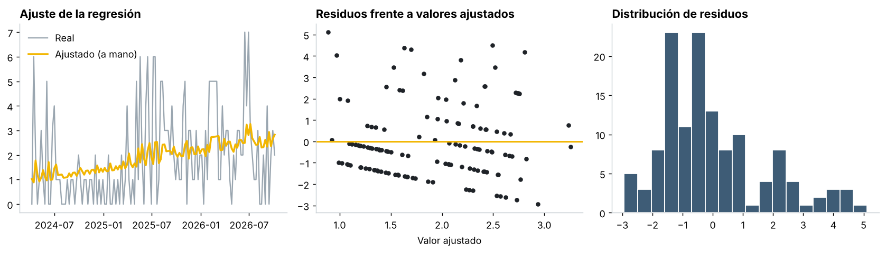
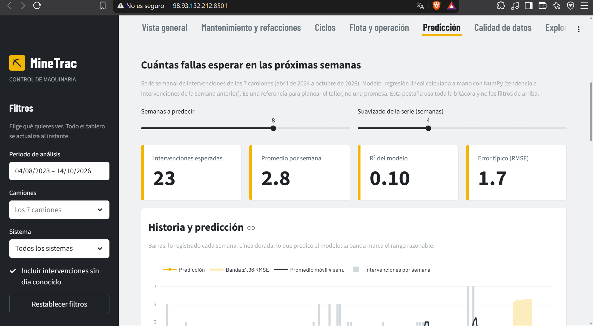
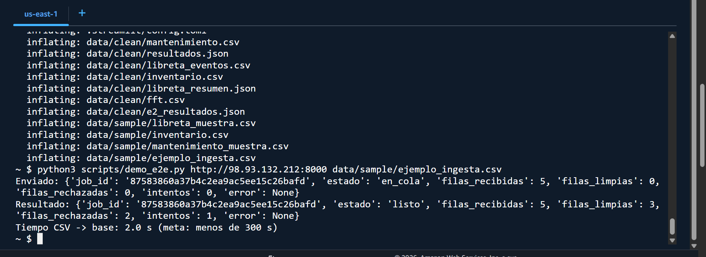

# E2. Cimientos en la nube de MineTrac

## Contexto y alcance

MineTrac es nuestra propuesta para ayudar a Máquinas Centella S.A. de C.V. a entender el mantenimiento de su maquinaria. Este informe corresponde a la entrega E2 del Proyecto Integrador Data Startup, en el TecNM campus Colima. En el E1 dejamos listo un tablero con los datos reales de la empresa. Ahora lo que hicimos fue convertirlo en una tubería que funciona sola: un archivo entra por una API, pasa por una cola, un proceso lo limpia y lo guarda en una base de datos, y el tablero, además, muestra un análisis de series de tiempo con una predicción.

Todo lo que usamos es información real de la empresa, que lleva sus registros a mano. Para esta entrega trabajamos con la bitácora de reparaciones de los 7 camiones (257 intervenciones). La empresa nos pidió enfocarnos en los camiones y los profesores lo autorizaron, así que ese es el alcance por ahora. Aun así, la limpieza, la cola y el análisis no dependen del tipo de equipo, por lo que más adelante se puede sumar el resto de la flota. Las fechas y los montos dudosos los dejamos marcados en lugar de rellenarlos por nuestra cuenta. Las horas trabajadas, las toneladas, las tarifas y los ingresos también se llevan a mano y todavía no están capturados, así que no entran en este análisis.

## Arquitectura

El flujo tiene cinco piezas:

Ingesta. Un microservicio hecho con FastAPI recibe un CSV y revisa que no esté vacío, que pese menos de 5 MB, que traiga las columnas obligatorias (equipo y fecha) y que no traiga columnas no permitidas. Responde enseguida con un número de trabajo.

Cola. La API deja el trabajo en una cola de Amazon SQS y no se queda esperando a que termine.

Worker. Toma el mensaje, limpia el archivo y guarda el resultado.

Base de datos. PostgreSQL con dos tablas: una de trabajos y otra de eventos limpios.

Tablero. La app de Streamlit lee los resultados desde un bucket privado de S3.

Si el worker falla, el mensaje regresa a la cola y se vuelve a intentar. Después de tres intentos fallidos pasa a una cola de mensajes muertos y el trabajo queda marcado como fallido, de modo que nada se pierde sin que nos enteremos. El procesamiento también es idempotente: un reintento borra lo que dejó el intento anterior, así que no se duplican filas.

## Limpieza automatizada con pruebas

La limpieza quedó como un módulo (services/worker/limpieza.py) que usa el worker. Cada regla es una función pequeña con su propia prueba:

El identificador del equipo se normaliza: sin espacios ni guiones y en mayúsculas.

Se aceptan fechas en formato ISO y día/mes/año. Se rechazan las futuras y las anteriores a 2015.

Los nombres de sistema se llevan a un catálogo, y los que no reconoce pasan a "otro".

A los montos se les quita el signo de pesos y las comas. Se rechazan los negativos y los mayores a 5 millones.

Se eliminan los duplicados.

Las filas rechazadas no se tiran: se conservan junto con el motivo del rechazo.

La suite completa tiene 46 pruebas y todas pasan. Once son de la limpieza, nueve del flujo completo (API, cola, worker y base de datos, con los reintentos y el mensaje muerto incluidos), cuatro del análisis y el resto viene de E0, E1 y el tablero.

## Series de tiempo

Para el análisis contamos las intervenciones por semana de los 7 camiones. Una intervención que toca varios sistemas cuenta una sola vez. Quedaron 132 semanas, del 1 de abril de 2024 al 5 de octubre de 2026, con 251 intervenciones y 34 semanas sin ninguna. La serie empieza en abril de 2024 porque antes de esa fecha la bitácora solo tiene tres intervenciones sueltas. Es una serie corta y de conteos pequeños (1.9 por semana en promedio, con un máximo de 7), y eso limita lo que cualquier modelo puede explicar.

Hicimos una descomposición aditiva con ciclo de 52 semanas. Lo más claro es la tendencia: en 2024 el taller registra cerca de una intervención por semana, sube hasta unas 2.7 a principios de 2026 y después baja un poco. La estacionalidad aparece fuerte en el cálculo (0.72), pero no la damos por concluyente. Con 132 semanas solo hay dos ciclos y medio, y varias posiciones del ciclo tienen una sola observación, así que el componente estacional termina absorbiendo esos datos y el residuo queda plano en un tramo. En el tablero lo explicamos de esta forma.

La prueba de Dickey-Fuller aumentada (ADF) rechaza la raíz unitaria en la serie original (estadístico de −3.30 y p de 0.015). Es decir, la serie es estacionaria al 5 %, aunque con una tendencia suave y mucho ruido. Con una diferencia lo es con mucha holgura (−11.99, p casi cero). En la autocorrelación, los rezagos 1 a 4 valen 0.22, 0.10, 0.30 y 0.27. Los rezagos 1, 3 y 4 pasan la banda de 95 % (±0.17) y el 2 no, y la autocorrelación parcial del primer rezago es 0.22. Hay algo de memoria, pero no un patrón fuerte, y con eso nos basta para justificar el uso de la semana anterior como variable de la regresión.

## Regresión lineal calculada a mano

Implementamos la ecuación normal, β = (XᵀX)⁻¹Xᵀy, con NumPy puro. El modelo explica las intervenciones de una semana con tres cosas: una constante, la tendencia (número de semana) y las intervenciones de la semana anterior. Usamos scikit-learn solo para comprobar el resultado, no interviene en el cálculo. Los tres coeficientes coinciden con los suyos con una diferencia máxima de 2 × 10⁻¹⁶.

Con 131 observaciones, los coeficientes son 0.8626 (constante), 0.0116 (tendencia) y 0.1465 (semana anterior). La tendencia es significativa (t de 2.74, p de 0.007), mientras que la semana anterior, por sí sola, no lo es (p de 0.097). El R² es 0.099 (0.085 ajustado) y el error típico es de 1.74 intervenciones por semana. En pocas palabras, el modelo capta que el ritmo del taller creció, pero explica poco de lo que pasa en cada semana. Por eso lo presentamos como una referencia para planear y no como un pronóstico de fallas individuales.

En los residuos, la media es prácticamente cero y el estadístico de Durbin-Watson es 2.00, así que no queda autocorrelación de primer orden. La prueba de Shapiro-Wilk rechaza la normalidad (p de 0.000001): los residuos tienen una cola a la derecha, que corresponde a las semanas con muchas intervenciones juntas. En la gráfica contra los valores ajustados se notan líneas diagonales, algo normal en datos de conteo. Por eso la banda de ±1.96 veces el error es solo una aproximación.

## Qué tanto dependen los resultados de las fechas dudosas

De las 257 intervenciones de la bitácora, 234 tienen fecha firme, 15 heredan la de la fila anterior, 4 se interpretaron del texto, 3 tienen el año corregido y 1 solo trae el año, por lo que queda fuera de la serie. Para ver cuánto pesan estas decisiones, repetimos la regresión con tres versiones de los datos. Con solo las fechas firmes (230 intervenciones en la serie), la tendencia es 0.0094 (p de 0.016) y el R² es 0.066. Si sumamos las interpretadas del texto y las de año corregido (237 intervenciones), la tendencia es 0.0101 (p de 0.012) y el R² es 0.078. Con todas (251 intervenciones, que es la versión que usamos), la tendencia es 0.0116 (p de 0.007) y el R² es 0.099.

La conclusión es la misma en las tres: hay una tendencia creciente y significativa, y el modelo explica poco. Lo único que cambia son los decimales.

## Tablero versión 2

Agregamos al tablero una pestaña de Predicción. Tiene dos controles (semanas a predecir, de 1 a 12, y suavizado de la serie) y cuatro indicadores: intervenciones esperadas, promedio por semana, R² y error típico. Debajo se muestra la gráfica de historia con la predicción y su banda, la descomposición en tendencia, estacionalidad y residuo, las gráficas de autocorrelación, el diagnóstico de residuos y la tabla de coeficientes. También hay un botón para descargar la predicción en CSV. Igual que el resto del tablero, lee sus datos de S3 con las credenciales del rol de la instancia.

## Demostración en AWS

Desplegamos la ingesta, el worker y PostgreSQL como contenedores en la misma instancia EC2 del tablero, y creamos la cola SQS con su cola de mensajes muertos. Para probarlo, un script de demostración sube un CSV de 5 filas a la API. El archivo pasó por la cola y el worker y quedó guardado en PostgreSQL en 2.0 segundos (la meta del curso es menos de 5 minutos). De las 5 filas, 3 salieron limpias y 2 se rechazaron: una por identificador inválido y otra por duplicada. Al terminar, las dos colas quedaron sin mensajes pendientes. La API está documentada con OpenAPI y se consulta en la ruta /docs del servicio.

## Límites y pendientes

La base de datos de la nube es un contenedor de PostgreSQL en la misma instancia, sin costo adicional. Migrar a un servicio administrado es opcional.

La dirección pública de la instancia cambia si se detiene, porque no asignamos una IP fija.

Los puertos de la API y del tablero están abiertos a internet sin autenticación mientras dura la evaluación, y los cerraremos después.

La serie semanal es corta (132 semanas) y algunas fechas se infirieron por el orden de la hoja.

Para el E3 vamos a usar esta misma base para el modelo ARIMA, el clasificador y la API de modelos.
