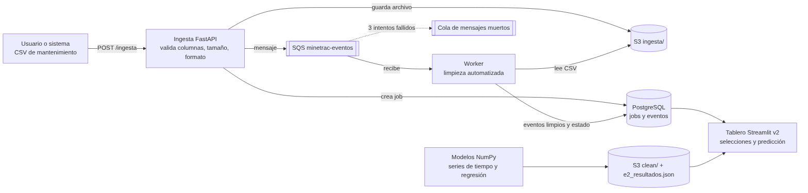
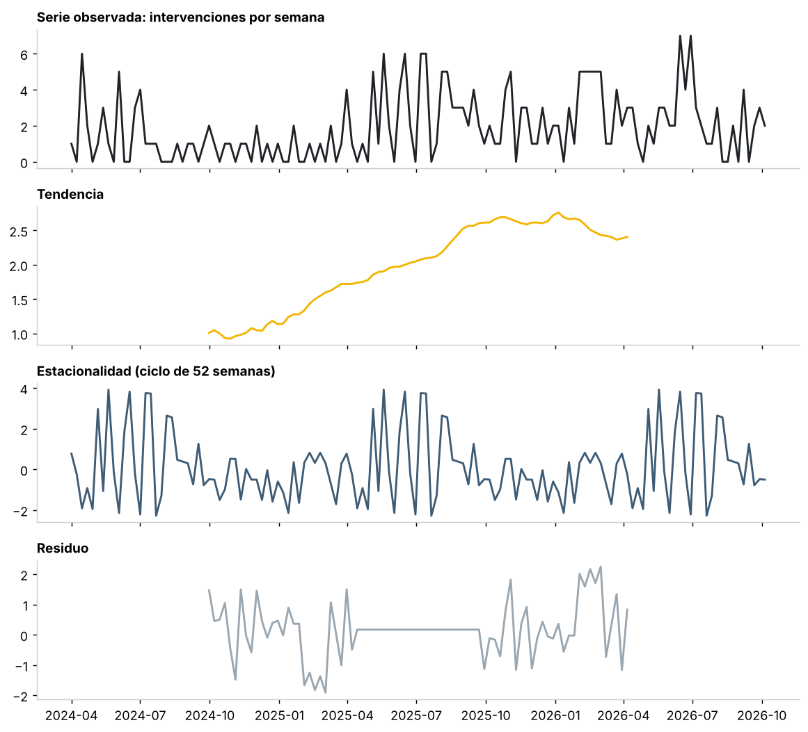
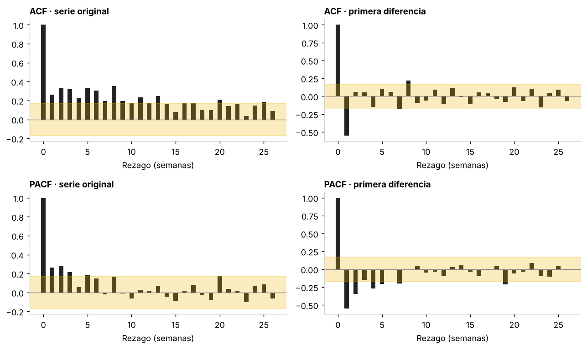
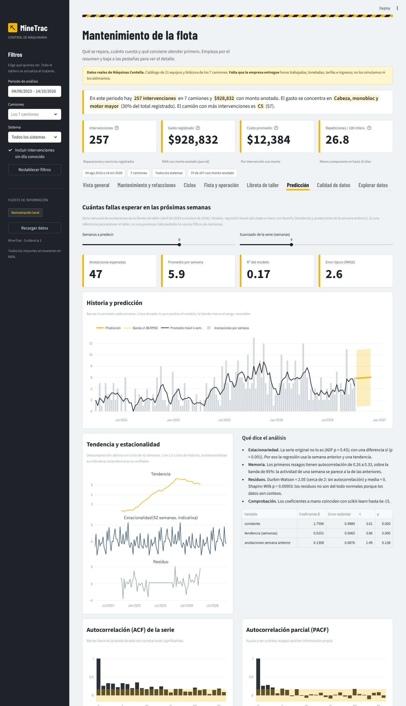
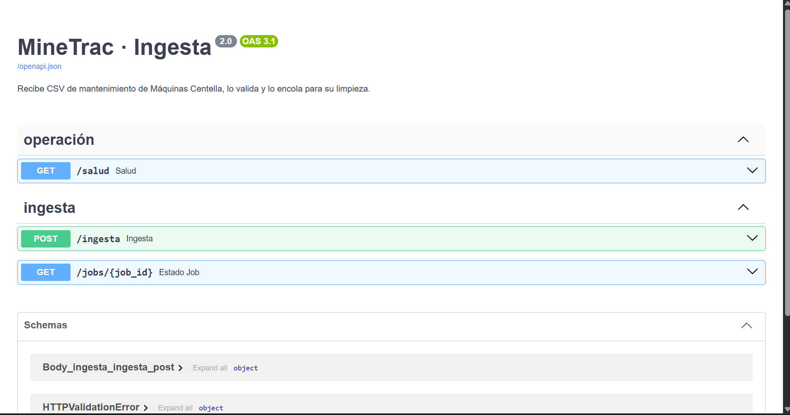
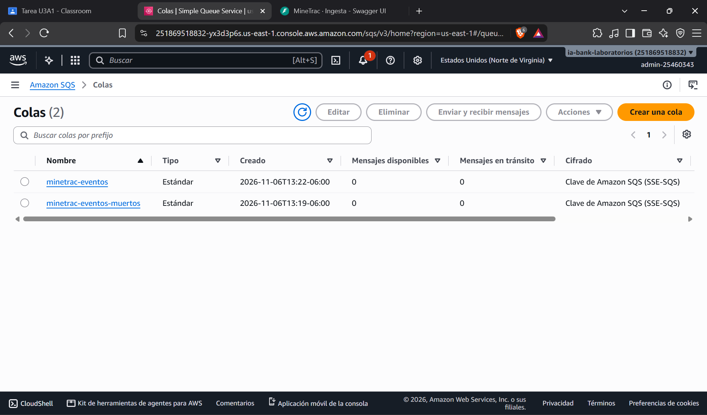

# E2. Cimientos en la nube de MineTrac

## Contexto y alcance

Con MineTrac buscamos ayudar a Máquinas Centella S.A. de C.V. a entender el mantenimiento de su maquinaria. Presentamos la entrega E2 del Proyecto Integrador Data Startup del TecNM campus Colima. En el E1 dejamos un tablero con los datos reales de la empresa. En este informe contamos cómo lo convertimos en una tubería automática: un archivo entra por una API, pasa por una cola, un proceso lo limpia y lo guarda en una base de datos, y el tablero muestra, además, un análisis de series de tiempo y una predicción.

Trabajamos solo con información real de la empresa. La empresa lleva sus registros a mano. Para este entregable usamos la bitácora de reparaciones de los 7 camiones (257 intervenciones). Por indicación de la empresa, autorizada por los profesores, el alcance actual son los camiones; la limpieza, la cola y el análisis no dependen del tipo de equipo, así que el resto de la flota se podrá agregar después. Las fechas y los montos dudosos quedan marcados y no los completamos por nuestra cuenta. Las horas trabajadas, las toneladas, las tarifas y los ingresos la empresa los lleva a mano y todavía no los tiene capturados, por lo que esas métricas quedan fuera de este análisis.

## Arquitectura

El flujo tiene cinco piezas. La primera es un microservicio de ingesta hecho con FastAPI. Recibe un archivo CSV, revisa que no esté vacío, que pese menos de 5 MB, que traiga las columnas obligatorias (equipo y fecha) y que no traiga columnas no permitidas, y responde de inmediato con un número de trabajo. La segunda pieza es una cola de mensajes de Amazon SQS: la API deja ahí el trabajo y no espera a que termine. La tercera es un worker que toma el mensaje, limpia el archivo y guarda el resultado. La cuarta es una base de datos PostgreSQL con dos tablas, una de trabajos y otra de eventos limpios. La quinta es el tablero de Streamlit, que lee los resultados del bucket privado de S3.

Si el worker falla, el mensaje vuelve a la cola y se reintenta. Tras tres intentos fallidos pasa a una cola de mensajes muertos y el trabajo queda marcado como fallido, de modo que nada se pierde en silencio. El procesamiento es idempotente: un reintento borra lo que dejó el intento anterior y no duplica filas.

## Limpieza automatizada con pruebas

Empaquetamos la limpieza como un módulo (services/worker/limpieza.py) que usa el worker. Cada regla es una función pequeña con su prueba. Normalizamos el identificador del equipo (quita espacios y guiones y lo pasa a mayúsculas), aceptamos fechas en formato ISO y día/mes/año y rechazamos las futuras o anteriores a 2015, llevamos los nombres de sistema a un catálogo (los desconocidos pasan a "otro"), limpiamos los montos (quitamos el signo de pesos y las comas, y rechazamos negativos o mayores a 5 millones) y eliminamos duplicados. Las filas rechazadas no se descartan en silencio: se conservan con el motivo.

La suite completa tiene 46 pruebas y todas pasan. Once cubren la limpieza, nueve cubren el flujo completo (API, cola, worker y base de datos, incluidos los reintentos y el mensaje muerto), cuatro cubren el análisis y el resto viene de las pruebas de E0 y E1 y del tablero.

## Series de tiempo

Para el análisis usamos las intervenciones por semana de los 7 camiones (una intervención que toca varios sistemas cuenta una vez): 132 semanas, del 1 de abril de 2024 al 5 de octubre de 2026, con 251 intervenciones y 34 semanas sin ninguna. Antes de abril de 2024 la bitácora solo trae tres intervenciones sueltas, por eso la serie empieza ahí. Es una serie corta y de conteos pequeños (1.9 por semana en promedio, con un máximo de 7), y eso limita lo que cualquier modelo puede explicar.

Hicimos una descomposición aditiva con ciclo de 52 semanas. La tendencia es lo más claro: durante 2024 el taller registra cerca de una intervención por semana, sube hasta unas 2.7 a principios de 2026 y después baja un poco. La estacionalidad sale fuerte en el cálculo (0.72), pero no la tomamos como concluyente: con 132 semanas solo hay dos ciclos y medio de 52 semanas, y varias posiciones del ciclo tienen una sola observación, así que el componente estacional absorbe esos datos y el residuo queda plano en un tramo. Lo decimos así en el tablero.

La prueba de Dickey-Fuller aumentada (ADF) rechaza la raíz unitaria en la serie original (estadístico de menos 3.30 y p de 0.015), así que la serie es estacionaria al 5 %, aunque con una tendencia suave y mucho ruido. Con una diferencia lo es con holgura (estadístico de menos 11.99 y p cercana a cero). En la autocorrelación de la serie original, los rezagos 1 a 4 valen 0.22, 0.10, 0.30 y 0.27; los rezagos 1, 3 y 4 superan la banda de 95 % (más o menos 0.17) y el 2 no, y la autocorrelación parcial del primer rezago es 0.22. Hay algo de memoria, pero no un patrón fuerte. Eso justifica usar la semana anterior como variable de la regresión.

## Regresión lineal calculada a mano

Implementamos la ecuación normal, β = (XᵀX)⁻¹Xᵀy, con NumPy puro. El modelo explica las intervenciones de una semana con una constante, la tendencia (número de semana) y las intervenciones de la semana anterior. scikit-learn solo sirve para comprobar el resultado, no interviene en el cálculo. Los tres coeficientes coinciden con los de scikit-learn con una diferencia máxima de 2 por 10 a la menos 16.

Con 131 observaciones, los coeficientes son 0.8626 para la constante, 0.0116 para la tendencia y 0.1465 para la semana anterior. La tendencia es significativa (t de 2.74, p de 0.007) y la semana anterior no lo es por sí sola (p de 0.097). El R² es 0.099 (0.085 ajustado) y el error típico es de 1.74 intervenciones por semana. En otras palabras, el modelo capta que el ritmo del taller creció, pero explica poco de la variación de cada semana, y lo presentamos como una referencia para planear y no como un pronóstico de fallas individuales.

En los residuos, la media es prácticamente cero y el estadístico de Durbin-Watson es 2.00, lo que indica que no queda autocorrelación de primer orden. La prueba de Shapiro-Wilk rechaza la normalidad (p de 0.000001) y los residuos tienen una cola a la derecha: son las semanas con muchas intervenciones juntas. En la gráfica contra los valores ajustados se ven líneas diagonales, propias de los conteos enteros. Es algo esperable en datos de conteo, y por eso la banda de más o menos 1.96 veces el error es una aproximación.

## Qué tanto dependen los resultados de las fechas dudosas

De las 257 intervenciones de la bitácora, 234 tienen fecha firme, 15 heredan la fecha de la fila anterior, 4 se interpretaron del texto, 3 tienen el año corregido y 1 solo trae el año, así que queda fuera de la serie. Repetimos la regresión con tres versiones de los datos. Con solo las fechas firmes (230 intervenciones en la serie) la tendencia es 0.0094 (p de 0.016) y el R² es 0.066. Con las firmes más las interpretadas del texto o de año corregido (237 intervenciones) la tendencia es 0.0101 (p de 0.012) y el R² es 0.078. Con todas (251 intervenciones, que es lo que usamos) la tendencia es 0.0116 (p de 0.007) y el R² es 0.099. La conclusión no cambia en ninguna versión: hay una tendencia creciente y significativa, y el modelo explica poco. Cambian los decimales.

## Tablero versión 2

Agregamos al tablero una pestaña de Predicción. Tiene dos controles (semanas a predecir, de 1 a 12, y suavizado de la serie), cuatro indicadores (intervenciones esperadas, promedio por semana, R² y error típico), la gráfica de historia con la predicción y su banda, la descomposición en tendencia, estacionalidad y residuo, las gráficas de autocorrelación, el diagnóstico de residuos, la tabla de coeficientes y un botón para descargar la predicción en CSV. Lee sus datos de S3 con las credenciales del rol de la instancia, igual que el resto del tablero.

## Demostración en AWS

Desplegamos la ingesta, el worker y PostgreSQL como contenedores en la instancia EC2 que ya usábamos para el tablero, y creamos la cola SQS con su cola de mensajes muertos. Con un script de demostración subimos un CSV de 5 filas a la API. El archivo pasó por la cola y el worker, y quedó guardado en PostgreSQL en 2.0 segundos (la meta del curso es menos de 5 minutos): 3 filas limpias y 2 rechazadas, una por identificador inválido y otra por duplicado. Al terminar, las dos colas quedaron sin mensajes pendientes. Documentamos la API con OpenAPI y se puede consultar en la ruta /docs del servicio.

## Límites y pendientes

La base de datos de la nube es un contenedor de PostgreSQL en la misma instancia (sin costo adicional); migrar a un servicio administrado es opcional. La dirección pública de la instancia cambia si se detiene, porque no asignamos una IP fija. Los puertos de la API y del tablero están abiertos a internet sin autenticación mientras dura la evaluación, y los cerraremos después. La serie semanal es corta (132 semanas) y algunas fechas están inferidas por el orden de la hoja. Para el E3 usaremos esta misma base para el modelo ARIMA, el clasificador y la API de modelos.
