# E3. Inteligencia en producción: modelos en la nube

## Contexto y alcance

Esta es la entrega E3 del Proyecto Integrador Data Startup de MineTrac, para Máquinas Centella S.A. de C.V. (TecNM campus Colima). En E2 dejamos la tubería de datos funcionando. Ahora sacamos los modelos del notebook y los pusimos a trabajar como un servicio en la nube: un pronóstico de intervenciones con ARIMA y un clasificador que estima si una falla se va a repetir.

Seguimos con los 7 camiones, que es el alcance que pidió la empresa y que autorizaron los profesores. Todo sale de la bitácora real de reparaciones; no usamos datos simulados. Los modelos no dependen del tipo de equipo, así que el resto de la flota se podrá sumar después.

Una aclaración sobre el horizonte: la guía pide pronosticar a 7 y 30 días, pero nuestra serie es semanal, porque con registros a mano la información diaria casi siempre está vacía. Por eso 7 días equivalen a 1 semana y 30 días a 4 semanas.

## Pronóstico con ARIMA

Elegimos el orden (p, d, q) con la autocorrelación, el criterio AIC y el diagnóstico de los residuos. Probamos una rejilla de 32 combinaciones, con p y q de 0 a 3 y d igual a 0 o 1. La prueba ADF de la serie original da p de 0.015, es decir, estacionaria al 5 %, pero la serie tiene una tendencia creciente que vimos en E2, y los modelos sin diferenciar dejan los residuos correlacionados: con ARIMA(1,0,0), por ejemplo, la prueba de Ljung-Box da p de 0.005. Con una diferencia, el ACF muestra su valor más fuerte y negativo en el primer rezago (−0.43), el segundo apenas pasa la banda (−0.20) y después se queda cerca de ella. Ese es el patrón de una media móvil de orden 1.

El orden que elegimos es ARIMA(0,1,1). Tiene un AIC de 523.7, a un punto del mejor de toda la rejilla (522.7 con el ARIMA(2,1,3), que además no converge), el BIC más bajo de todos (529.4) y es el más simple. Sus residuos no muestran autocorrelación (Ljung-Box con p de 0.11). El coeficiente de la media móvil es −0.88, lo que equivale a un suavizado exponencial con memoria larga. No usamos SARIMA: con 132 semanas solo caben dos ciclos y medio de 52 semanas, y un componente estacional anual no se puede estimar con confianza, como ya vimos en E2.

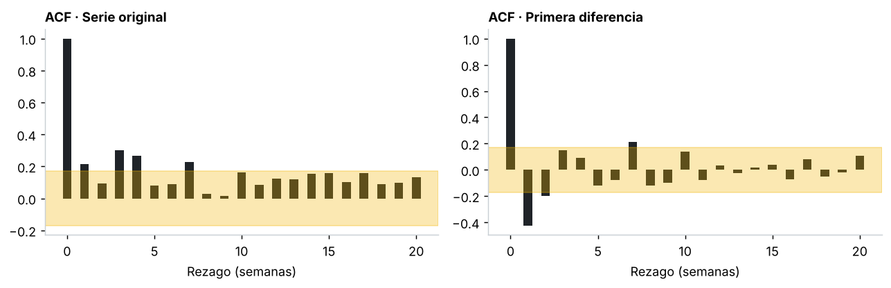

El pronóstico a 7 días es de 2.01 intervenciones, con una banda al 95 % de 0 a 5.4. A 30 días son 4 semanas de 2.01 cada una, unas 8 intervenciones en total, con una banda de 0 a 5.5 por semana. La línea es plana porque este tipo de modelo, sin estacionalidad, proyecta el nivel actual de la serie. La banda es ancha porque los conteos semanales son pequeños y muy variables, y el límite inferior se recorta en 0, ya que no existen conteos negativos.

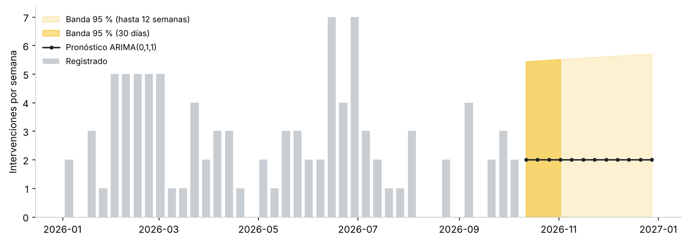

Como revisión de sensatez (el backtesting completo es del E4), ajustamos el modelo sin las últimas 12 semanas y las pronosticamos. El error absoluto medio fue de 1.88 intervenciones contra 2.50 de un modelo ingenuo que repite el promedio de las últimas cuatro semanas, y las 12 semanas reales cayeron dentro de la banda. Es una buena señal, pero con una sola ventana de prueba no la tomamos como definitiva.

## Clasificador de repetición de fallas

La pregunta es: dado un registro de mantenimiento de un camión, ¿el mismo sistema de ese camión volverá a registrarse en los siguientes 1 a 30 días? Usamos el conjunto del Avance 1, con 284 registros de objetivo conocido (los demás son demasiado recientes para saberlo). Las variables son el sistema, el mes, el día de la semana, los días desde el registro anterior del camión, los registros de los últimos 90 días, los del mismo sistema en ese periodo y si la bitácora declara pieza y proveedor. Dejamos fuera el monto porque 71 % de los registros no lo trae.

El corte es temporal: entrenamos con el 80 % más antiguo (227 registros, hasta abril de 2026) y probamos con el 20 % más reciente (57 registros, de abril a septiembre de 2026), para no usar el futuro para predecir el pasado. Comparamos Naive Bayes, KNN, SVM con núcleo RBF y un árbol de decisión, junto con dos referencias: predecir siempre la clase más frecuente y predecir siempre que sí se repite. El modelo se elige con el F1 medio de una validación cruzada temporal sobre el conjunto de entrenamiento, no con la prueba, para no escoger mirando las respuestas.

Naive Bayes sale primero, con un F1 de 0.85 en la prueba y 0.64 en validación cruzada. Detecta las 38 repeticiones reales, pero a costa de marcar casi todo como repetición: solo acierta 6 de 19 casos que no se repiten. KNN (F1 de 0.57) y SVM (0.62) son más equilibrados, pero fallan más en la validación cruzada. El árbol de profundidad 3 termina prediciendo siempre que no se repite y no sirve. Lo importante es leerlo con honestidad: la referencia de "siempre se repite" ya obtiene un F1 de 0.80, así que Naive Bayes mejora poco, y su AUC de 0.69 indica una capacidad de separación modesta. Además, en el periodo de prueba se repite el 67 % de los casos contra el 43 % del de entrenamiento, porque el taller tuvo más actividad reciente, y eso mueve todas las métricas.

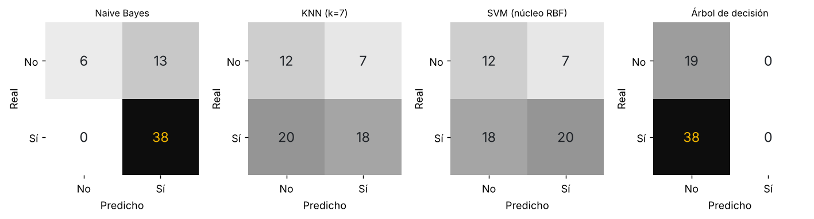

Con 284 registros y variables débiles, el clasificador sirve para ordenar casos por probabilidad y no para decidir por sí solo. Con más historia y con el horómetro de cada camión debería mejorar. Por eso la API avisa que la probabilidad no está calibrada.

## API de modelos

Los dos modelos se sirven con FastAPI en el servicio services/modelos. POST /pronostico recibe el horizonte en días y el nivel de la banda, y devuelve el pronóstico por semana con su intervalo. POST /clasificar recibe las variables de un registro y devuelve la probabilidad de repetición y la clase. También hay un GET /salud y la documentación OpenAPI en /docs. Las entradas se validan con Pydantic: un sistema que no existe, un mes de 13 o un valor negativo regresan un error 422 claro. El ARIMA se ajusta una sola vez al arrancar el servicio y no en cada petición.

La suite de pruebas llega a 64 pruebas, todas en verde. Las nuevas cubren las bandas del pronóstico, la búsqueda del orden, el corte temporal del clasificador, los dos endpoints, las validaciones y que el Naive Bayes exportado para la función serverless da la misma probabilidad que scikit-learn.

## Contenedores y despliegue en AWS

La API se empaqueta con un Dockerfile multi-stage: una etapa instala las dependencias en un entorno virtual y la imagen final solo lleva ese entorno, el código y los artefactos, y corre con un usuario sin permisos de administrador. Las versiones de las librerías están fijas, porque el clasificador se guarda con joblib y debe cargarse con la misma versión de scikit-learn. El docker-compose.yml del repositorio incluye ahora el servicio de modelos junto al resto de la pila.

Nuestra primera idea fue construir la imagen directamente en la instancia EC2, pero se trabó: la instancia es pequeña y le quedaban 3.4 GB de disco. Cambiamos a construirla en AWS CodeBuild, que la guarda en el registro ECR (175 MB comprimida), y la instancia solo la descarga. Así quedó funcionando en la instancia, en el puerto 8010.

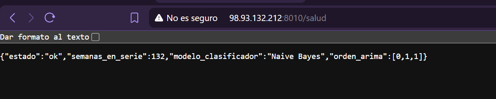

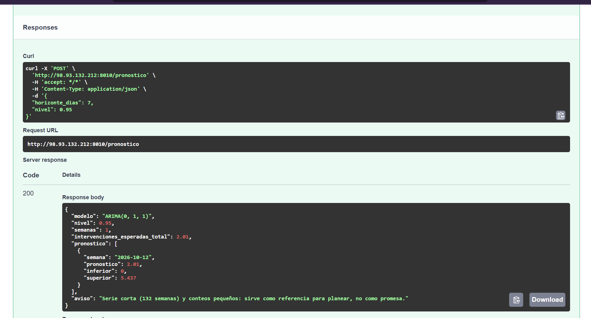

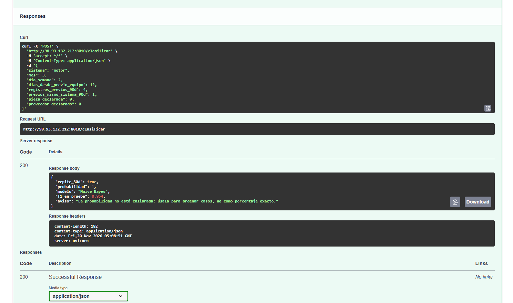

Para el contenedor administrado quisimos usar AWS App Runner, pero la cuenta no lo tiene habilitado (error SubscriptionRequiredException), así que usamos ECS con Fargate, que la guía también permite. El servicio corre una tarea con la misma imagen, 1 vCPU y 2 GB, con IP pública, y quedó activo con 1 de 1 tarea en ejecución.

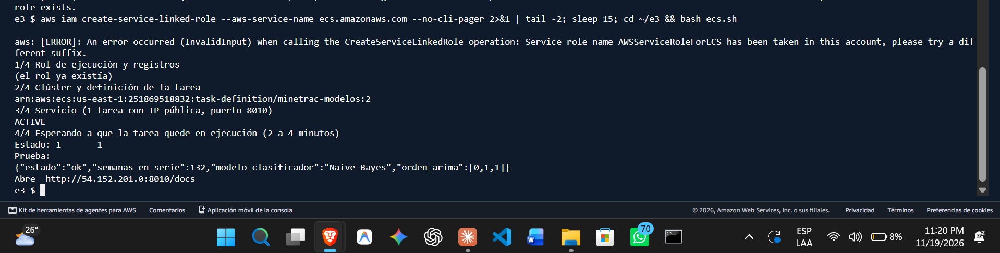

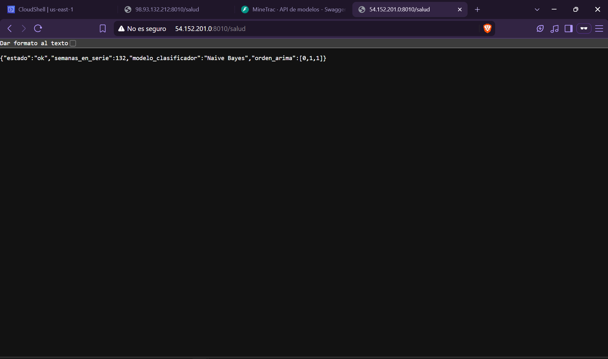

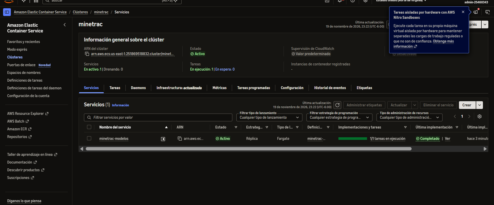

Para la parte serverless desplegamos el clasificador como función de AWS Lambda con URL pública. Como el paquete de Lambda no puede cargar scikit-learn con comodidad, exportamos el Naive Bayes a un archivo JSON (medias, varianzas, probabilidades previas y los pasos de imputación y escalado) y la función calcula la probabilidad en Python puro. Pesa 2 KB y da el mismo resultado que la API, que comprobamos con una prueba.

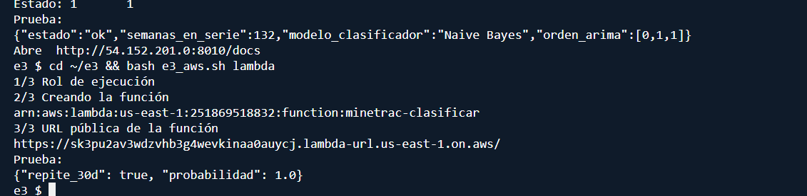

## Prueba de carga con Locust

Corrimos 50 usuarios simultáneos durante 60 segundos contra la API en la instancia EC2, con una mezcla de peticiones a /clasificar, /pronostico y /salud. Salieron 1,214 peticiones, con 20 por segundo. La mediana fue de 400 ms, pero el percentil 95 subió a 2.4 segundos y el máximo a 16 segundos, y fallaron 28 peticiones (2.31 %), todas con la conexión reiniciada por el servidor.

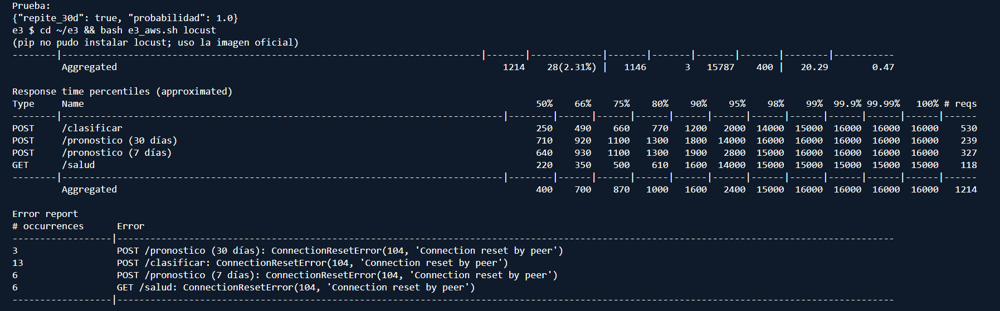

Revisando el código encontramos dos causas. La primera: la API reajustaba el ARIMA en cada petición, lo que satura una instancia de un solo núcleo que además comparte recursos con PostgreSQL, la ingesta y el tablero. La segunda: cuando llegaban muchas peticiones justo al arrancar, el servicio empezaba a atenderlas antes de terminar de cargar los modelos y respondía con error 500. Corregimos las dos: el ARIMA se ajusta una sola vez al iniciar y la carga se hace bajo un candado. Con el código corregido, la misma prueba de 50 usuarios en nuestra máquina de desarrollo dio 0 fallos en 1,017 peticiones, aunque esa cifra no es comparable con la de la instancia de AWS. Todavía no repetimos la prueba en AWS con la imagen corregida, y es lo primero que haremos.

## Kubernetes

Escribimos los manifiestos en la carpeta k8s: un Deployment con 2 réplicas, sondas de salud y límites de recursos, y un Service de tipo NodePort, con instrucciones para correrlos en un clúster local. Todavía no los desplegamos en un clúster, por falta de tiempo, así que quedan sin validar y los dejamos como pendiente.

## Límites y pendientes

- Repetir Locust en AWS con la imagen corregida y volver a desplegar la instancia y ECS con ella.
- Desplegar y validar los manifiestos de Kubernetes en un clúster local o en la nube.
- Los puertos 8010 (y los de E2) están abiertos a internet sin autenticación mientras dura la evaluación; los cerraremos después. La protección de la API es parte del E4.
- La serie semanal es corta (132 semanas) y el clasificador usa solo 284 registros con objetivo conocido, con un cambio de proporción entre el periodo de entrenamiento y el de prueba. Con más datos de la empresa los resultados deberían mejorar.
- Para el E4 sigue el backtesting walk-forward contra el modelo ingenuo, la red recurrente y las cadenas de Markov.
